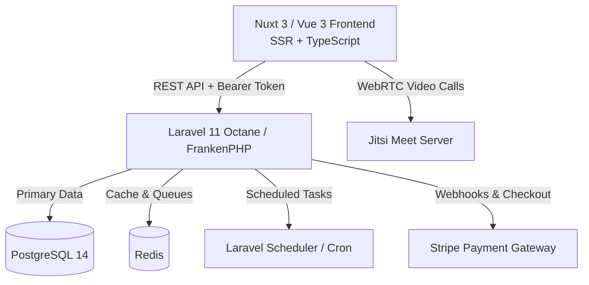

# ConsultFlow — SaaS Booking & Consultation Platform

[](https://laravel.com)
[](https://nuxt.com)
[](https://vuejs.org)
[](https://www.postgresql.org)
[](https://redis.io)
[](https://www.docker.com)
[](https://frankenphp.dev)

A modern, production-grade **SaaS Booking & Consultation Platform** connecting customers with verified experts. Built with a high-performance **Laravel 11 Octane** backend and a responsive **Nuxt 3 / Vue 3** frontend.

---

## 🌟 Key Features

### 1. 🔍 Discovery & Consultant Profiles
- **Faceted Search & Filters:** Filter consultants by hourly rate, minimum star rating (1–5 stars), and specialized tags.
- **Dynamic Slot Generation:** Calculates 30-minute booking intervals based on actual consultant availability (`working_hours`), accounting for day-of-week logic (ISO 1–7) and active appointments.
- **Public Profile:** Bio, expertise tags, verified badge, reviews, and direct messaging link.

### 2. 📅 Concurrency-Safe Booking Engine
- **Double-Booking Prevention:** Utilizes PostgreSQL row-level locking (`FOR UPDATE`) within database transactions to serialize simultaneous bookings on overlapping time slots.
- **Self-Booking Guard:** Consultants are strictly prohibited from booking appointments with their own profiles.
- **Meeting Link Automation:** Automatically provisions a live consultation room link upon booking confirmation.

### 3. 💳 Payments, Wallets & Financial Integrity
- **Stripe Checkout & Webhooks:** Integrated with Stripe for wallet top-ups. Includes signature verification and idempotency checks to prevent duplicate wallet credits.
- **Internal Wallet System:** Clients can pay directly using their internal wallet balance.
- **Safe Withdrawal Flow:** Prevents race conditions and double-spending via atomic row-level locks on wallet records during payout requests.
- **Dynamic Platform Fee:** Platform commission is read dynamically from the database (`settings` table) via the Strategy Pattern (`StandardPricingStrategy`).

### 4. 📹 Live Video Consultation Room
- **Embedded Jitsi Meet:** Built-in video conferencing directly inside the browser (`/room/[id]`) with no third-party desktop app installation required.
- **Post-Call Review & Rating Modal:** Automatic prompt upon call completion for 1–5 star reviews, feedback tags, and comments.

### 5. 💬 In-App Live Messaging & Notifications
- **Real-Time Direct Chat:** 1-to-1 conversation system between clients and consultants with bounded query limits (latest 50 messages) and active polling.
- **Notification Center:** Categorized alerts (*Booking Updates*, *Payments*, *System Alerts*) with unread badges, mark-all-as-read, and direct action links.

### 6. ⚙️ Automation & Background Scheduler
- **Appointment Reminders:** Automated reminder emails sent 60 minutes prior to call time (`booking:remind` every minute).
- **Auto-Complete Sessions:** Automatically marks confirmed bookings as `completed` once their end time has passed (`booking:complete` every 15 minutes).
- **Monthly Consultant Payouts:** Automated batch payout job executing on the 1st of every month (`ProcessConsultantPayoutsJob`).

### 7. 🛡️ Multi-Role Portals & Management
- **Client Portal (`/client/*`):** My bookings, favorite consultants, billing history, and notification settings.
- **Provider Hub (`/provider/*`):** Calendar availability schedule, incoming bookings, earnings overview, and profile editor.
- **Admin Dashboard (`/admin/*`):** Platform-wide metrics, consultant verification approval/rejection, user ban management, transaction approvals, and global platform settings.

---

## 🏗️ Architecture & Technology Stack



### Technology Highlights

| Layer | Technologies & Patterns |
|---|---|
| **Backend** | Laravel 11, FrankenPHP (Octane Worker), PHP 8.3, Sanctum Auth, Eloquent ORM |
| **Frontend** | Nuxt 3 (SSR), Vue 3 Composition API, TypeScript, Pinia, Tailwind CSS |
| **Database** | PostgreSQL 14 (ACID Transactions, Row-Level Locking) |
| **Caching & Queues** | Redis (Resilient Serialization, Fail-Safe Cache Eviction) |
| **External Services** | Stripe API, Jitsi Meet WebRTC, Google OAuth 2.0 (Socialite) |
| **DevOps** | Docker, Docker Compose, Multi-stage builds |

---

## 🚀 Quick Start (Docker Compose)

### Prerequisites
- [Docker Desktop](https://www.docker.com/products/docker-desktop/) installed and running.
- [Git](https://git-scm.com/) installed.

### 1. Clone the Repository
```bash
git clone https://github.com/hiimthien/saas-booking.git
cd saas-booking
```

### 2. Environment Configuration
Copy the environment template files for both backend and frontend:

```bash
# Backend Environment
cp backend/.env.example backend/.env

# Frontend Environment
cp frontend/.env.example frontend/.env
```

Ensure your `backend/.env` has the database and cache configured for Docker:
```env
DB_CONNECTION=pgsql
DB_HOST=postgres
DB_PORT=5432
DB_DATABASE=laravel
DB_USERNAME=laravel
DB_PASSWORD=laravel

CACHE_STORE=redis
QUEUE_CONNECTION=redis
REDIS_HOST=redis
REDIS_PORT=6379
```

### 3. Build & Start Containers
```bash
docker compose up -d --build
```

### 4. Database Setup & Seeding
```bash
# Run database migrations
docker compose exec backend php artisan migrate

# Seed sample data (users, consultants, availability slots, tags)
docker compose exec backend php artisan db:seed

# Clear application cache
docker compose exec backend php artisan cache:clear
```

### 5. Access the Platform
- **Frontend App:** [http://localhost:3000](http://localhost:3000)
- **Backend API:** [http://localhost:8000/api](http://localhost:8000/api)
- **API Health Check:** [http://localhost:8000/api/health](http://localhost:8000/api/health)

---

## 🔑 Default Demo Accounts

After running `php artisan db:seed`, you can log in with:

| Role | Email | Password | Access Portal |
|---|---|---|---|
| **Admin** | `admin@consultflow.com` | `password` | `/admin/dashboard` |
| **Consultant** | `consultant@consultflow.com` | `password` | `/provider/dashboard` |
| **Client** | `client@consultflow.com` | `password` | `/client/dashboard` |

---

## 🧪 Testing

Run backend automated tests inside the container:
```bash
docker compose exec backend php artisan test
```

---

## 📂 Project Directory Structure

```text
saas-booking/
├── backend/                       # Laravel 11 Octane API Application
│   ├── app/
│   │   ├── Console/Commands/      # Scheduler commands (AutoComplete, Reminders)
│   │   ├── Http/Controllers/Api/  # Namespaced Controllers (Public, Customer, Consultant, Admin)
│   │   ├── Models/                # Eloquent Models (User, Consultation, Wallet, Setting, Chat)
│   │   ├── Services/              # Business Logic (BookingService, ConsultantService, WalletService)
│   │   └── Strategies/Pricing/    # Pricing strategies (StandardPricingStrategy)
│   ├── database/migrations/       # Database migrations & schemas
│   └── routes/api.php             # 70+ clean REST API endpoints
├── frontend/                      # Nuxt 3 / Vue 3 Application
│   ├── app/
│   │   ├── components/            # Atomic & domain UI components (SearchFilter, ReviewModal, etc.)
│   │   ├── layouts/               # Role-based layouts (default, client, provider, admin)
│   │   ├── pages/                 # Full responsive routes matching mockups
│   │   ├── services/              # API consumption layer
│   │   └── stores/                # Pinia state management (auth store)
│   └── nuxt.config.ts             # Nuxt configuration (SSR, Tailwind, Pinia)
├── mockup/                        # 29 Original UI HTML/Tailwind design specifications
├── docker-compose.yml             # Orchestration for Frontend, Backend, PostgreSQL & Redis
└── README.md                      # Project documentation
```

---

## 📄 License
This project is open-sourced software licensed under the [MIT license](LICENSE).

